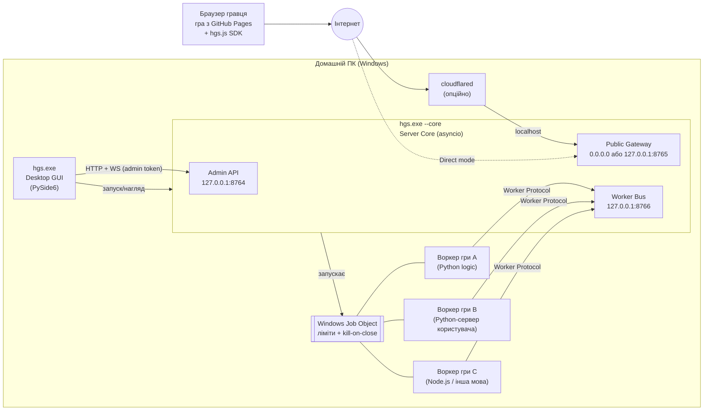
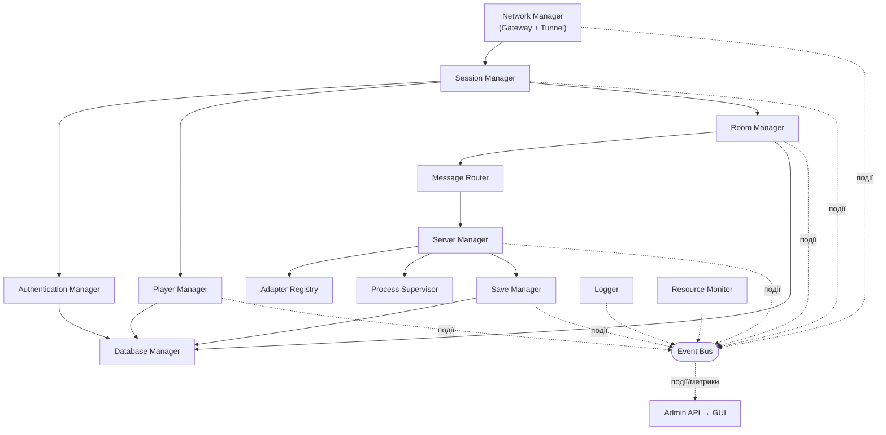
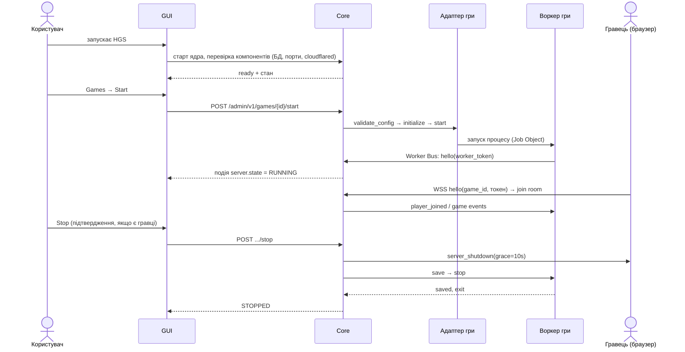
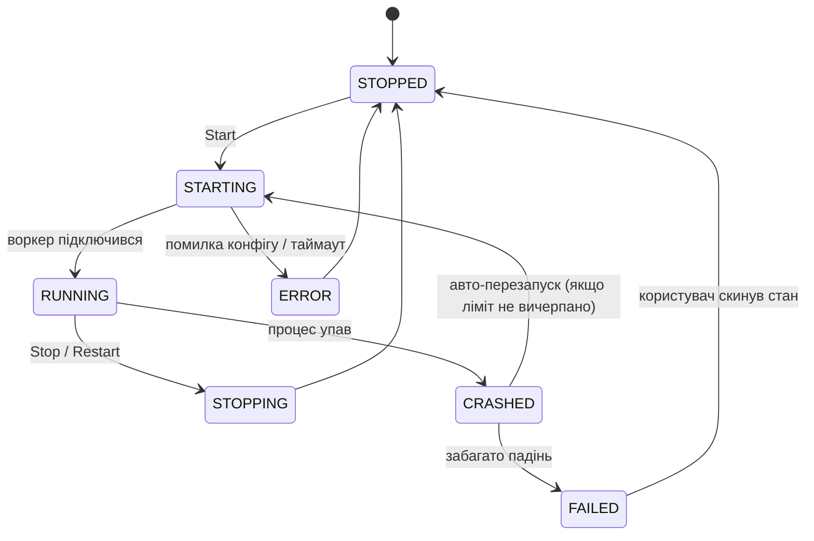

# 01. Огляд архітектури HOME GAME SERVER (HGS)

Статус: **Етап 1 — проєкт на погодження**. Коду ще немає.

## 1.1. Що таке HGS

HGS — домашня ігрова серверна платформа для Windows. Одна програма, одне спільне ядро, багато ігор.
Ядро відповідає за **інфраструктуру** (мережа, гравці, кімнати, безпека, процеси, збереження, логи).
Кожна гра відповідає за **власну логіку** через адаптер. Універсального «протоколу всіх ігор» немає:
ядро передає ігрові події як непрозорі дані, які розуміє лише конкретна гра.

## 1.2. Ключові архітектурні рішення

| # | Рішення | Чому |
|---|---------|------|
| A1 | **GUI і ядро — окремі процеси.** GUI (PySide6) запускає ядро як дочірній процес і керує ним через локальний Admin API. | GUI ніколи не блокується роботою серверів; падіння ядра не закриває GUI (показуємо помилку і кнопку перезапуску); у майбутньому ядро можна запускати без GUI. |
| A2 | **Ігрова логіка працює в окремих процесах-воркерах**, а не всередині ядра. | Помилка, зависання чи витік пам'яті в одній грі не зачіпають ядро та інші ігри (вимоги 11, 17.10). Можна обмежувати ресурси кожної гри окремо. |
| A3 | **Один публічний порт (Gateway) для всіх ігор.** Гра обирається в першому повідомленні. | Один тунель/один проброс порту/один сертифікат обслуговує всі ігри. Безкоштовний Cloudflare Quick Tunnel дає одну адресу — цього достатньо. |
| A4 | **Ядро — «сторож» мережі.** Автентифікація, ліміти, валідація, кімнати виконуються в ядрі до того, як повідомлення дійде до гри. | Ігри, створені з Claude, не мусять самі реалізовувати безпеку. Кімнати ізольовані на рівні ядра. |
| A5 | **Мовно-незалежний Worker Protocol** (JSON через локальний WebSocket). | Python-ігри використовують готовий `hgs_sdk`, але будь-яка мова (Node.js, Go, C#…) може підключитися тим самим протоколом — це і є основа Custom Adapter. |
| A6 | **Режим `relay` без серверного коду.** | Наявні HTML-ігри з клієнтською логікою можна підключити, не пишучи сервер: ядро пересилає події в межах кімнати й зберігає спільний стан кімнати. |
| A7 | **Admin API доступний лише на 127.0.0.1** з випадковим токеном на кожен запуск. | Адмін-панель ніколи не потрапляє в інтернет (вимога 6). |
| A8 | **Нічого не запускається автоматично.** Ігрові сервери стартують лише за кнопкою Start. | Вимога 12. |

## 1.3. Технологічний стек (результат аналізу)

| Компонент | Вибір | Обґрунтування / альтернативи |
|-----------|-------|------------------------------|
| Мова | **Python 3.12** (3.13 також підтримується) | 3.12 — найширша підтримка колес PySide6/PyInstaller/pywin32 на Windows. Фіксуємо мінімум 3.12. |
| GUI | **PySide6 (Qt Widgets)** | Офіційні Qt-біндинги, LGPL (безкоштовно). Widgets, а не QML — простіше пакування PyInstaller і стабільніша поведінка. |
| GUI ↔ ядро | **QtNetwork + QtWebSockets** (входять до PySide6) | Неблокуючі HTTP/WS-запити в циклі подій Qt без додаткових залежностей і без змішування asyncio з Qt. |
| Async-ядро | **asyncio** (стандартна бібліотека) | — |
| HTTP/WS-сервер | **uvicorn + FastAPI (Starlette)** | Один ASGI-стек для трьох слухачів: Admin API, Public Gateway, Worker Bus. Uvicorn підтримує TLS (WSS) і `ws_max_size`. FastAPI дає OpenAPI-документацію Admin API та pydantic. |
| Валідація конфігів/повідомлень | **pydantic v2** (приходить разом із FastAPI) | Строгі схеми, зрозумілі помилки. Нова залежність не додається. |
| БД | **SQLite через стандартний `sqlite3`** у виділеному потоці-записувачі | Без `aiosqlite`/ORM: менше залежностей, режим WAL, атомарні транзакції. |
| Моніторинг | **psutil** | CPU/RAM/мережа системи й дерева процесів. Єдиний надійний кросплатформний варіант. |
| Windows-специфіка | **pywin32** | Job Objects (ліміти RAM/CPU, автоматичне вбивство воркерів при аварії HGS), DPAPI (шифрування секретів), коректні сигнали завершення. Одна залежність закриває три задачі. |
| Хешування паролів | `hashlib.scrypt` (stdlib) | Без зовнішніх бібліотек. |
| Токени | `secrets.token_urlsafe` (stdlib) | Криптостійкий генератор. |
| Тунель | **cloudflared** (окремий безкоштовний бінарник, не Python-залежність) | Quick Tunnel не потребує акаунта/домену. Інші провайдери — через інтерфейс `TunnelProvider`. |
| Збірка | **PyInstaller 6.x**, режим `--onedir` | `onedir` запускається швидше й рідше дає хибні спрацьовування антивірусів, ніж `onefile`. |
| Тести | **pytest** (+ `pytest-asyncio`) — лише для розробки | Не потрапляють у збірку. |

Точні версії фіксуються в `requirements.txt` на Етапі 2 після перевірки встановлення.
Відмовились: `aiosqlite`, SQLAlchemy, `keyring`, `qasync`, `websockets` як окремий сервер — не потрібні при обраній схемі.

## 1.4. Процесна модель

* Один виконуваний файл `hgs.exe` з режимами: без аргументів — GUI; `--core` — серверне ядро;
  `--worker <game_id>` — вбудований Python-воркер (для запакованої версії, де немає окремого python.exe).
* Admin-токен передається ядру через stdin-пайп (не через аргументи командного рядка — їх видно в диспетчері задач).
* Усі ігрові процеси додаються до Job Object з прапорцем `KILL_ON_JOB_CLOSE`: якщо ядро аварійно завершиться
  або ПК вимикається, Windows сама завершить ігрові процеси — «сиріт» не лишається.
* Single-instance: файл-замок у каталозі даних не дає запустити дві копії HGS.

## 1.5. Компоненти ядра (коротко)

Детально — у [02-core-modules.md](02-core-modules.md).

## 1.6. Основний сценарій (вимога 12)

## 1.7. Стани ігрового сервера

Захист від нескінченного перезапуску: за замовчуванням не більше **3 перезапусків за 10 хвилин**
з експоненційною затримкою (2 с, 8 с, 30 с). Після цього — стан `FAILED`, потрібна дія користувача.
За замовчуванням політика перезапуску — `on_crash`, її можна вимкнути (`never`).

## 1.8. Зміст документації

1. [01-overview.md](01-overview.md) — цей документ
2. [02-core-modules.md](02-core-modules.md) — модулі ядра
3. [03-adapters.md](03-adapters.md) — система адаптерів, BaseAdapter, HTML/Python/Custom
4. [04-network.md](04-network.md) — Network Gateway, режими доступу, тунелі
5. [05-security.md](05-security.md) — безпека
6. [06-protocol.md](06-protocol.md) — клієнтський протокол і Worker Protocol
7. [07-config-and-data.md](07-config-and-data.md) — конфігурації, БД, збереження, файли
8. [08-gui.md](08-gui.md) — графічний інтерфейс
9. [09-js-sdk.md](09-js-sdk.md) — JavaScript SDK
10. [10-project-structure.md](10-project-structure.md) — структура репозиторію
11. [11-roadmap.md](11-roadmap.md) — етапи, задачі, тести
12. [12-game-integration.md](12-game-integration.md) — процес підключення наявних ігор
