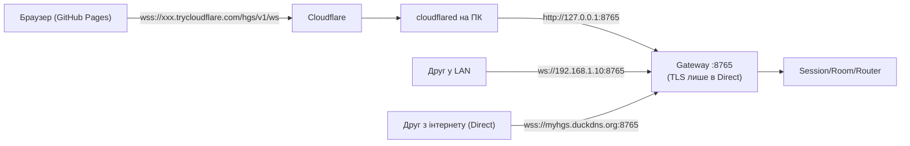

# 04. Мережева система

## 4.1. Головна проблема, яку треба врахувати

Ігри на GitHub Pages відкриваються через **HTTPS**. Браузер забороняє такій сторінці підключатися до
незахищеного `ws://` (mixed content). Виняток — `ws://localhost` / `ws://127.0.0.1` у Chrome/Edge/Firefox,
тому локальне тестування працює без сертифіката. **Друзі з інтернету можуть підключитися лише через `wss://` з
дійсним сертифікатом.** Самопідписаний сертифікат у браузері не працює без ручних дій кожного гравця.

Звідси висновок: для гри з GitHub Pages найпростіший безкоштовний шлях — **тунель** (він дає готовий HTTPS).
Пряме підключення з WSS можливе, але вимагає безкоштовного доменного імені й сертифіката (складніше).

## 4.2. Network Gateway

Gateway — єдина «вхідна точка» для гравців, незалежна від способу зовнішнього доступу. Адаптери ігор нічого
не знають про тунелі, IP чи сертифікати.



Маршрути Gateway (публічні, мінімальні):

| Шлях | Призначення |
|------|-------------|
| `WS /hgs/v1/ws` | основне з'єднання гравця |
| `POST /hgs/v1/auth/invite` | обмін коду запрошення на токен гравця (також доступно через WS) |
| `GET /hgs/v1/health` | перевірка досяжності (без чутливих даних) |
| `GET /hgs/v1/info?game=<id>` | назва сервера, чи працює гра, режим входу, версія протоколу |
| `GET /hgs/sdk/hgs.js` | JavaScript SDK (можна й підключити копію з репозиторію гри) |
| `WS/HTTP /hgs/v1/proxy/{game_id}/…` | проксі до `standalone`-сервера (Етап 5) |

Ніяких адміністративних маршрутів на цьому порту немає — вони фізично в іншому застосунку на іншому порту.

## 4.3. Режими доступу

### Режим 1: Localhost / LAN

* `local` — Gateway слухає `127.0.0.1` (тільки цей ПК). Типовий режим при першому запуску.
* `lan` — `0.0.0.0`; GUI показує LAN-адресу. Windows Firewall спитає дозвіл (HGS не змінює брандмауер сам;
  в інструкції описано, як дозволити тільки «Приватні мережі»).
* Без TLS. З GitHub Pages працює тільки `ws://localhost` на тому ж ПК; для LAN-друзів — гра має бути відкрита
  по `http://` (наприклад, локальна копія) або використовуйте тунель.

### Режим 2: Direct Internet

Вимоги: публічна IP-адреса (не CGNAT), проброс порту на роутері, для браузерних ігор — домен і сертифікат.

* Безкоштовний домен: **DuckDNS** (`*.duckdns.org`), HGS оновлює IP через їхній API (токен зберігається
  зашифровано) — вирішує проблему динамічної IP.
* Сертифікат: Let's Encrypt через DNS-01 для DuckDNS (без відкриття порту 80). Реалізація — на Етапі 4;
  до того можна вказати готові файли `cert.pem`/`key.pem`.
* Проброс порту: вручну в роутері (інструкція) або опційно UPnP (за явною згодою, вимкнено за замовчуванням).
* Gateway вмикає TLS (uvicorn `ssl_certfile`/`ssl_keyfile`).

### Режим 3: Tunnel

Інтерфейс `TunnelProvider`:

```python
class TunnelProvider(ABC):
    name: ClassVar[str]
    def is_available(self) -> Availability          # чи встановлено бінарник/чи є налаштування
    async def start(self, local_port: int) -> None
    async def stop(self) -> None
    def public_url(self) -> str | None              # https://...
    def state(self) -> TunnelState                  # stopped/starting/connected/reconnecting/failed
    def limitations(self) -> list[str]              # показується в GUI
```

Провайдери (за пріоритетом реалізації):

| Провайдер | Вартість | Акаунт / домен | Адреса | Обмеження (показуємо в GUI) |
|-----------|----------|----------------|--------|-----------------------------|
| **Cloudflare Quick Tunnel** (`cloudflared tunnel --url`) | безкоштовно | не потрібні | випадкова `https://*.trycloudflare.com`, **змінюється при кожному запуску** | для тестів і розробки; без гарантій доступності (SLA); обмеження кількості одночасних запитів; Cloudflare може змінити умови |
| **Cloudflare Named Tunnel** | безкоштовно | безкоштовний акаунт Cloudflare + **власний домен** у Cloudflare | постійна, напр. `https://play.mydomain.com` | потрібен домен (зазвичай платний); токен тунелю зберігається через DPAPI |
| **Tailscale Funnel** (Етап 4+, опційно) | безкоштовний персональний план | акаунт Tailscale | постійна `https://<пк>.<tailnet>.ts.net` | обмеження портів і пропускної здатності Funnel; потрібен встановлений Tailscale |

Чесні застереження в GUI: тунель залежить від стороннього сервісу та інтернету; HGS **не гарантує** постійну
доступність; адреса Quick Tunnel змінюється — гравцям треба надсилати нове запрошення.

`cloudflared` — окремий офіційний бінарник. HGS не завантажує його мовчки: GUI показує кнопку «Завантажити з
офіційного GitHub Cloudflare», після згоди завантажує, перевіряє контрольну суму SHA-256 із релізу
та кладе в `%LOCALAPPDATA%\HGS\bin\`. Можна вказати вже встановлений шлях.

Tunnel Manager читає вивід `cloudflared`, знаходить публічну URL, стежить за процесом і перезапускає його при
падінні (з тим самим захистом від нескінченного перезапуску).

## 4.4. Діагностика мережі (вкладка Network)

* **Публічна IP**: запит до безкоштовного сервісу (наприклад, `api.ipify.org`, без ключа; можна вимкнути).
* **Ознаки CGNAT**: якщо WAN-адреса роутера (через UPnP, якщо доступно) в діапазоні `100.64.0.0/10` або
  приватному, чи відрізняється від публічної IP → показуємо «Ймовірно CGNAT: Direct не працюватиме,
  використовуйте тунель».
* **Перевірка досяжності**:
  * Tunnel — ядро робить запит `GET https://<tunnel>/hgs/v1/health` і перевіряє, що відповів саме цей
    екземпляр HGS (у відповіді — випадковий `instance_nonce`). Запит іде через інтернет і назад — це реальна
    перевірка.
  * Direct — та сама перевірка через публічний домен/IP. Якщо роутер не підтримує «hairpin NAT», локальна
    перевірка може хибно провалитися; GUI пропонує перевірити з телефону через мобільний інтернет (з QR-кодом
    адреси `…/hgs/v1/health`).
* **Зовнішня адреса для гравців**: GUI показує готовий `serverUrl` для SDK і кнопку «Скопіювати посилання
  запрошення» (`https://<user>.github.io/<game>/?hgs=<serverUrl>&invite=<code>`).

## 4.5. Розриви з'єднання

* Ping/pong кожні 15 с (тунелі розривають неактивні WebSocket приблизно через 100 с).
* Розрив гравця → сесія `DETACHED` на 30 с → SDK перепідключається з `resume_token` і повертається в кімнату.
* Падіння тунелю → Tunnel Manager перезапускає `cloudflared`; GUI показує стан `reconnecting`. Якщо адреса
  Quick Tunnel змінилася — подія `tunnel.url_changed` і помітне попередження.
* Втрата інтернету на ПК → локальні гравці (LAN) продовжують грати; ядро і сервери не зупиняються.
