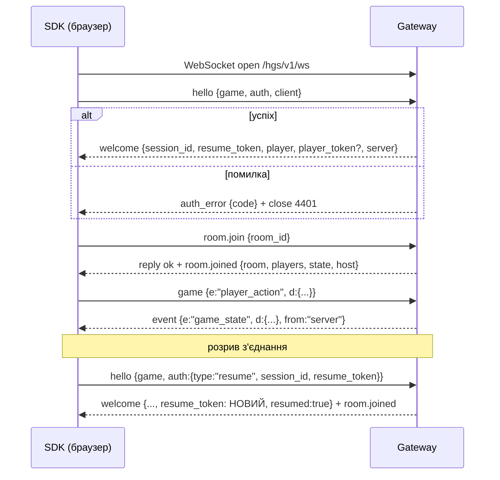

# 06. Протоколи обміну

HGS має два протоколи:

1. **Client Protocol** — браузер/клієнт гравця ↔ Gateway (`/hgs/v1/ws`).
2. **Worker Protocol** — процес гри ↔ ядро (`ws://127.0.0.1:8766/worker`).

Обидва — JSON-повідомлення в текстових WebSocket-кадрах. Версія протоколу: `1`.
Ігрові дані (`d` у подіях гри) — **непрозорі** для ядра: ядро перевіряє лише розмір і те, що це валідний JSON.
Структуру ігрового стану визначає кожна гра сама.

## 6.1. Конверт повідомлення

```json
{ "v": 1, "t": "room.join", "id": "c7", "seq": 12, "d": { ... } }
```

| Поле | Обов'язкове | Опис |
|------|-------------|------|
| `v` | так | версія протоколу |
| `t` | так | тип повідомлення (`^[a-z][a-z0-9_.]{0,63}$`) |
| `id` | ні | ідентифікатор запиту, якщо клієнт чекає відповідь (`reply` з `re`) |
| `seq` | так (клієнт → сервер) | строго зростаючий номер у межах сесії; дублікати/старі відкидаються |
| `d` | ні | дані |

Відповідь на запит:

```json
{ "v": 1, "t": "reply", "re": "c7", "ok": true,  "d": { ... } }
{ "v": 1, "t": "reply", "re": "c7", "ok": false, "error": { "code": "room_full", "message": "Room is full" } }
```

Коди помилок: `bad_request`, `unauthorized`, `forbidden`, `rate_limited`, `too_large`, `invalid_seq`,
`room_not_found`, `room_full`, `room_closed`, `game_unavailable`, `version_unsupported`, `banned`, `internal`.

## 6.2. Client Protocol — життєвий цикл



### `hello` (перше повідомлення, протягом 5 с)

```json
{ "v":1, "t":"hello", "seq":1, "d":{
  "game": "tank-arena",
  "auth": { "type": "invite", "code": "K7Q2-M9XA-PD", "name": "Oleh" },
  "client": { "sdk": "hgs.js/1.0.0", "game_version": "1.4.2" }
}}
```

Варіанти `auth`:
`{type:"token", token}` · `{type:"invite", code, name}` · `{type:"password", name, password}` ·
`{type:"account", username, password, register?:bool}` · `{type:"open", name}` ·
`{type:"resume", session_id, resume_token}`.

### `welcome`

```json
{ "v":1, "t":"welcome", "d":{
  "session_id": "s_8f3k...", "resume_token": "…", "resumed": false,
  "player": { "id": "p_x1y2", "name": "Oleh" },
  "player_token": "…",   // лише коли видано новий (після invite/password/account)
  "server": { "protocol": 1, "heartbeat_s": 15, "resume_window_s": 30,
              "limits": { "max_message_bytes": 16384, "messages_per_s": 30 } }
}}
```

### Повідомлення клієнт → сервер

| `t` | `d` | Опис |
|-----|-----|------|
| `ping` | `{}` | heartbeat (SDK робить автоматично) |
| `room.list` | `{}` | список відкритих кімнат гри |
| `room.create` | `{name, max_players?, private?, params?}` | якщо гра дозволяє |
| `room.join` | `{room_id}` або `{code}` | приєднатися (гравець у грі — максимум в одній кімнаті) |
| `room.leave` | `{}` | вийти |
| `room.state.set` | `{state}` | лише `relay`; заміна спільного стану (за замовчуванням — тільки хост) |
| `room.state.patch` | `{patch}` | лише `relay`; поверхневе злиття ключів |
| `game` | `{e, d, to?}` | ігрова подія; `e` — назва події гри; `to` — id гравця (лише relay) |

### Повідомлення сервер → клієнт

| `t` | Опис |
|-----|------|
| `welcome`, `auth_error`, `reply`, `pong` | службові |
| `room.joined` | `{room:{id,name,max_players,params}, players:[...], state, host}` |
| `room.player_joined` / `room.player_left` | `{player, reason?}` |
| `room.host_changed` | `{host}` |
| `room.state` | новий/змінений стан кімнати (relay) |
| `room.closed` | `{reason}` |
| `event` | `{e, d, from}` — ігрова подія від сервера гри (`from:"server"`) або гравця (relay) |
| `kicked` | `{reason}` + закриття з кодом 4403 |
| `server_shutdown` | `{grace_s, reason}` — сервер гри зупиняється |
| `error` | помилка, не прив'язана до запиту |

Коди закриття WebSocket: `4400` некоректний протокол, `4401` не автентифіковано, `4403` kick/ban,
`4408` таймаут hello, `4409` сесію перехоплено новим з'єднанням, `4413` завеликий кадр, `4429` флуд,
`4503` гра зупинена. SDK за кодом вирішує, чи перепідключатися (`4401/4403` — ні).

## 6.3. Гарантії

* Порядок повідомлень у межах одного з'єднання зберігається.
* Доставка — «не більше одного разу». Під час розриву події не буферизуються (крім стану кімнати, який
  надсилається при поверненні). Ігри, яким потрібна надійність, надсилають повний стан періодично
  або за запитом — це рішення гри.

## 6.4. Worker Protocol (ядро ↔ процес гри)

Підключення: `ws://127.0.0.1:8766/worker`, перше повідомлення:

```json
{ "v":1, "t":"w.hello", "d":{ "token":"<HGS_WORKER_TOKEN>", "game_id":"tank-arena", "api":1, "sdk":"hgs_sdk-py/1.0.0" } }
```

Ядро відповідає `w.welcome {config, rooms}`. Один токен — одне підключення.

### Ядро → воркер

| `t` | `d` | Відповідь воркера |
|-----|-----|-------------------|
| `w.room.created` / `w.room.closed` | `{room}` | — |
| `w.player.join` (з `id`) | `{room_id, player}` | `reply {accept:bool, reason?, state?}` |
| `w.player.event` | `{room_id, player_id, e, d}` | — |
| `w.player.leave` | `{room_id, player_id, reason}` | — |
| `w.save` (з `id`) | `{reason}` | `reply {format:"json"|"b64", data}` або `{supported:false}` |
| `w.load` | `{format, data}` | `reply {ok}` |
| `w.shutdown` | `{grace_s, reason}` | воркер зберігає і завершується |
| `w.ping` | `{}` | `w.pong` |

### Воркер → ядро

| `t` | `d` | Опис |
|-----|-----|------|
| `w.ready` | `{}` | гра готова приймати гравців (після цього стан `RUNNING`) |
| `w.send` | `{room_id, e, d, to?:[pid], except?:[pid]}` | надіслати подію гравцям кімнати |
| `w.room.update` | `{room_id, status?, params?, max_players?}` | змінити кімнату |
| `w.room.close` | `{room_id, reason}` | закрити кімнату |
| `w.kick` | `{room_id, player_id, reason}` | вилучити гравця з кімнати |
| `w.status` | `{custom:{...}}` | довільні метрики гри для GUI |
| `w.log` | `{level, msg}` | структурований лог (stdout/stderr теж збираються) |

Ядро перевіряє, що кожен `room_id`/`player_id` належить грі цього воркера; порушення → відмова +
`security.alert`.

## 6.5. Версіонування

* Поле `v` у кожному повідомленні; Gateway приймає підтримувані версії й відповідає `version_unsupported`
  для невідомих.
* Додавання нових типів і необов'язкових полів — без зміни версії; невідомі поля ігноруються.
* Видалення/зміна значення полів — нова версія, стара підтримується щонайменше один мажорний реліз.
